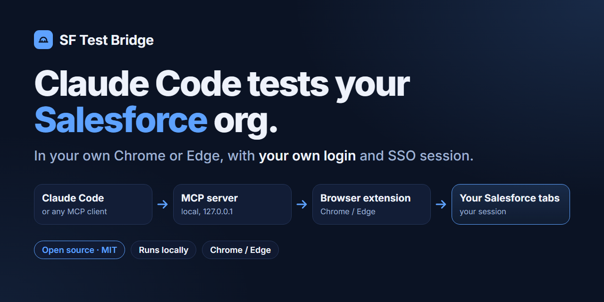
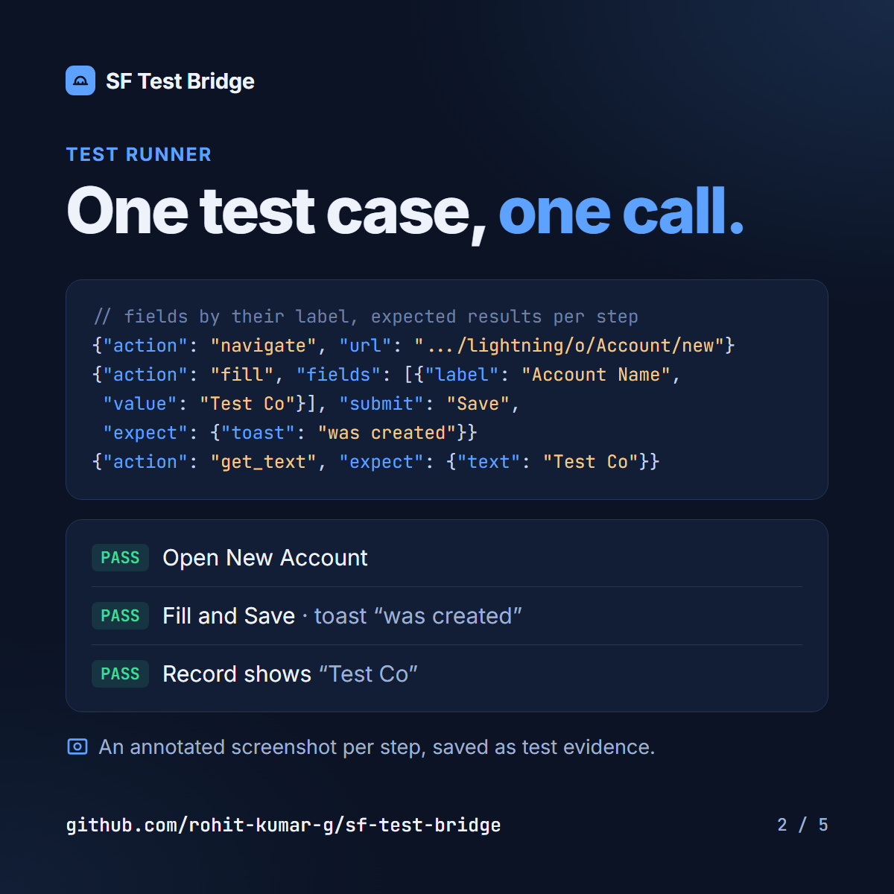
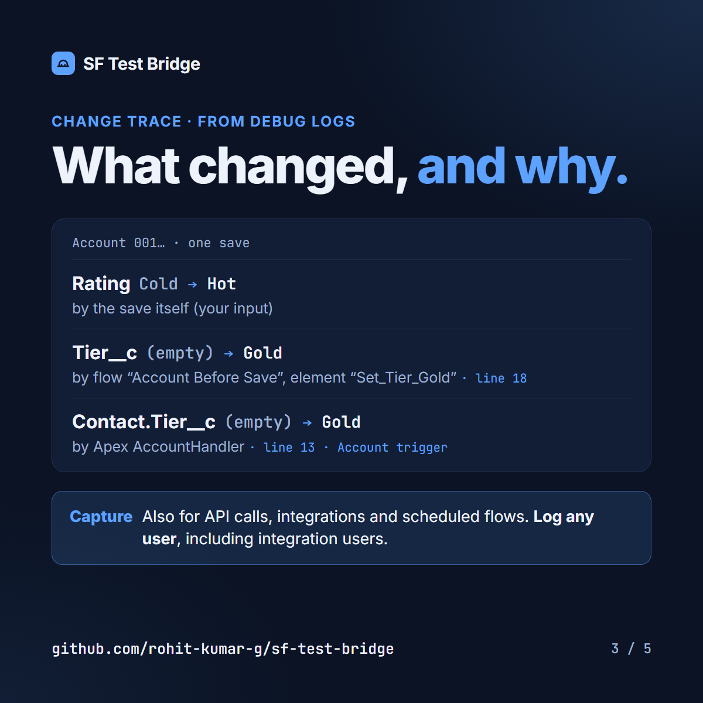
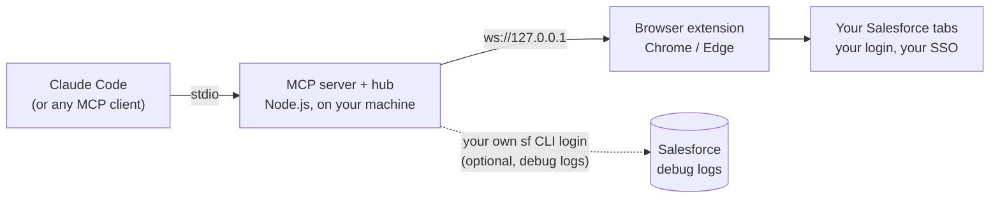

<p align="center">
  
</p>

<h1 align="center">SF Test Bridge</h1>

<p align="center">
  <b>Let Claude Code test Salesforce in your own Chrome or Edge, with the logins and SSO sessions you already have.</b>
</p>

<p align="center">
  <a href="https://github.com/rohit-kumar-g/sf-test-bridge/actions/workflows/ci.yml"></a>
  <a href="https://github.com/rohit-kumar-g/sf-test-bridge/releases"></a>
  <a href="LICENSE"></a>
  
  
  
</p>

<p align="center">
  <a href="#quick-start">Quick start</a> ·
  <a href="#features">Features</a> ·
  <a href="#how-it-works">How it works</a> ·
  <a href="docs/safety.md">Safety</a> ·
  <a href="#documentation">Docs</a> ·
  <a href="CHANGELOG.md">Changelog</a>
</p>

---

## Why

AI coding agents are good at writing Salesforce code, but checking the result means clicking through the org. Embedded and automated browsers break on SSO and MFA logins, and handing an agent your password is not an option.

SF Test Bridge connects Claude Code to **the browser you already use**. Claude opens its own tabs next to yours, reads Lightning pages as text, fills fields by their label, runs whole test cases, and explains what your automation changed, all inside your existing session. It never logs in and never sees a password.

It's built for the **developer's inner loop**: build in a sandbox, developer or scratch org, then have Claude check that it works.

## Features

| | |
|---|---|
| **Your real browser** | Works in your own Chrome or Edge profile: SSO, MFA and every org you're logged into. Claude gets its own window and tab group, so your tabs stay yours. |
| **Lightning-aware actions** | Reads pages as text (shadow DOM and iframes included), fills fields by label (picklists, lookups, dates, multi-selects), clicks record actions, moves the Path. |
| **Test cases in one call** | `browser_steps` runs a whole test case with expected results and returns PASS/FAIL per step, plus annotated screenshots as evidence and a review dashboard. |
| **What changed, and why** | From Salesforce debug logs: each field's before → after and what set it (a flow element, an Apex line, a workflow rule or your input), with a timeline and a shareable `trace.md`. |
| **Capture any change** | Catch the logs of an API call, an integration, a scheduled flow or a colleague's edit. Add logging for **any user**: integration and API-only users, Automated Process, guest and portal users. |
| **Verify your deployment** | `sf_verify_change` reads your git diff and checks each change in the real org: deployed, matches the source, on the layout, and shows on the form. |
| **Safe by design** | Production is read-only for agents, destructive actions need your click, agents must follow your rules and agree a brief before changing data, and site lists limit where Claude can act. |
| **Local only** | Everything runs on your machine over `127.0.0.1`. Logs and evidence never leave it. |

<p align="center">
  
  
</p>

## How it works



- The **extension** acts only on tabs Claude opened or tabs you share, using Chrome's debugger API so clicks and typing behave like a real user's.
- The **MCP server** gives Claude the tools, enforces the safety rules, and runs a small hub so several Claude sessions can share one browser, each in its own lane.
- **Debug logs** are optional and read through your own Salesforce CLI login. The browser session is never used for that.

## Quick start

**Requirements:** [Node.js](https://nodejs.org) 20+, Chrome or Edge 120+, and [Claude Code](https://claude.com/claude-code) (or another MCP client).

**1. Get the code**

```bash
git clone https://github.com/rohit-kumar-g/sf-test-bridge.git
cd sf-test-bridge/mcp-server
npm install
```

**2. Load the extension.** Open `chrome://extensions` (or `edge://extensions`), turn on **Developer mode**, click **Load unpacked** and choose the `extension/` folder. Its ID is always `kokfnnhacmipalbbndbpnbhpfhilopef`; the MCP server accepts only that ID.

**3. Register the MCP server** once for all your projects, with the full path on your machine:

```bash
claude mcp add --scope user browser -- node /path/to/sf-test-bridge/mcp-server/src/index.js
```

Other MCP clients take the same command: `{ "mcpServers": { "browser": { "command": "node", "args": ["/path/to/sf-test-bridge/mcp-server/src/index.js"] } } }`. Inside this repository, `.mcp.json` (Claude Code) and `.vscode/mcp.json` (VS Code) already register it.

**4. Restart Claude Code and check.** The extension's toolbar icon shows **on** when it's connected. Ask Claude to *"run browser_doctor"*: it checks the setup and says what to fix.

**5. Log in to Salesforce yourself** in that browser, then ask Claude something like:

> Open my org, create an Account named Test Co, and check that it saved.

**Optional: debug logs.** Log the Salesforce CLI into your org (`sf org login web`), then use **Debug logs → Set up…** in the extension popup. See [Debug logs](docs/debug-logs.md).

### Example: one test case in one call

```json
{"steps": [
  {"action": "navigate", "url": "https://yourdomain.lightning.force.com/lightning/o/Account/new"},
  {"action": "fill", "fields": [{"label": "Account Name", "value": "Test Co"}], "submit": "Save", "expect": {"toast": "was created"}},
  {"action": "get_text", "expect": {"text": "Test Co"}}
]}
```

## Safety at a glance

- **No credentials, ever.** The bridge never logs in, never types into password fields and blocks cookie access. It only works inside sessions you opened.
- **Your rules first.** Every agent session must read your instructions (`~/.sf-test-bridge/charter.md`) before any browser tool works, and agree a **brief** with you before changing data.
- **Production is read-only** for agents until you allow writes for a set time. **Delete, Merge, Convert, Change Owner and mass updates** wait for your click in the popup, in any org.
- **Allowed and blocked sites.** By default Claude works on record, list and app pages; Setup, builders and developer tools are blocked.
- **Pause** in the popup stops everything at once.

Full details: [Safety, privacy and allowed sites](docs/safety.md).

## Share it with your team

Each person installs it on their own machine (steps above); nobody shares logins.

- **Same rules for every agent.** Keep one `charter.md` in a team repo and point everyone at it: `claude mcp add --scope user -e BROWSER_BRIDGE_CHARTER=/path/to/team/charter.md browser -- node …/index.js`
- **Central settings.** IT can set the site lists, block production writes and turn off setup reading through Chrome policy ([`extension/managed_schema.json`](extension/managed_schema.json)).
- **Never share** `evidence/`, `logs/` or the debug log cache: they can contain customer data from the org.
- **Updating:** `git pull`, reload the extension, restart Claude Code. `browser_doctor` warns when the extension and server versions differ.

## Documentation

| Guide | What's in it |
|---|---|
| [Tools and test evidence](docs/tools.md) | Every tool, test cases in one call, the evidence dashboard |
| [Safety, privacy and allowed sites](docs/safety.md) | Agent instructions and briefs, production and destructive actions, site lists, logs |
| [Debug logs, change trace and capture](docs/debug-logs.md) | Root cause of failures, what changed and why, capturing any user's changes |
| [Checking your changes against the org](docs/org-checks.md) | `sf_verify_change`, reading an object's setup |
| [Configuration, sessions and the command line](docs/configuration.md) | Environment variables, several Claude sessions, the CLI |

## Limits

- Chromium browsers only (Chrome, Edge; Brave should work). Firefox and Safari are not supported.
- `browser_evaluate` runs in the top frame only; reading, clicking and typing work in every frame.
- `browser_upload` can't reach file inputs inside cross-origin iframes.
- A screenshot of an allowed page still shows the pixels of a blocked iframe inside it.
- Developed and tested mainly on Windows; plain Node.js, and CI runs on Linux and Windows.

## Contributing

Issues and pull requests are welcome. See [CONTRIBUTING.md](CONTRIBUTING.md) for the setup, the tests and the project layout. Please report security issues privately as described in [SECURITY.md](SECURITY.md).

## License

[MIT](LICENSE)

SF Test Bridge is an independent open-source project. It is not affiliated with, endorsed or sponsored by Salesforce, Inc. or Anthropic. Salesforce and Lightning are trademarks of Salesforce, Inc.; Claude is a trademark of Anthropic.
